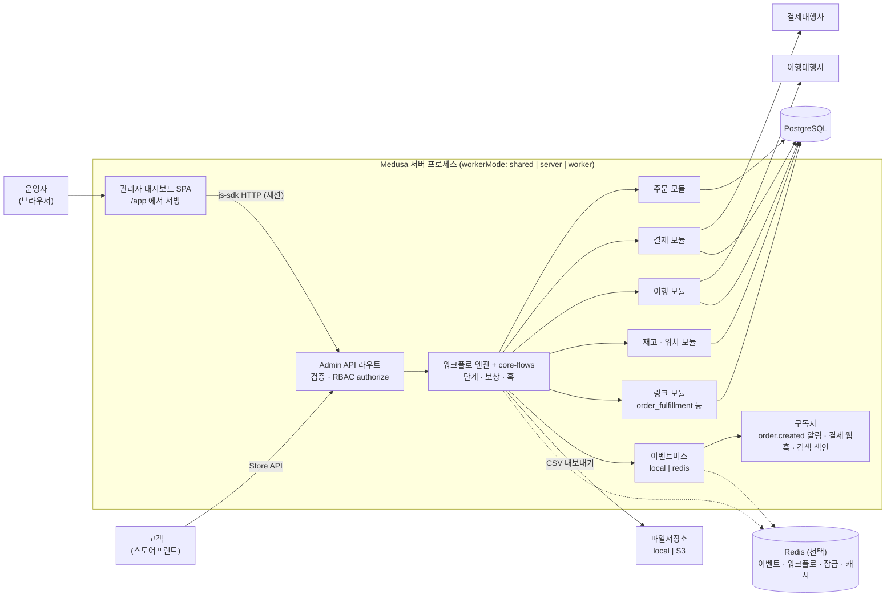

# Medusa 주문 관리(Admin) AS-IS 설계 분석서

## 1. 개요

### 1.1 분석 범위

- **대상**: Medusa 관리자 대시보드의 **주문 영역 전체**와, 이 영역이 호출하는 백엔드다. 사용자가 고른 범위이며, 다음을 포함한다.
  - UI: `/orders` 라우트 트리의 17개 페이지. 목록, 내보내기, 상세, 그리고 상세 아래의 하위 작업 화면 14개다.
  - API: `packages/medusa/src/api/admin`의 orders, returns, claims, exchanges, order-edits, order-changes, payments, payment-collections, reservations 라우트.
  - 워크플로: `packages/core/core-flows`의 주문·결제·이행 워크플로.
  - 모듈: order, payment, fulfillment, inventory(+stock-location), 그리고 링크 모듈과 이벤트버스.
- **제외**: 아래 항목은 주문 화면에서 링크나 호출로 닿지만, 사용자가 정한 범위 밖이라 결과 화면만 기록하고 내부는 분석하지 않았다.
  - 고객, 상품, 설정(위치·배송 옵션), 사용자, 드래프트 주문 화면.
  - 스토어프런트와 스토어 API. 주문 생성, 결제 링크 결제, 이전 수락은 경계로만 표시했다.
  - 외부 결제·이행 제공자의 내부 동작.
- **기준선**: 저장소 `medusa2`(원래 `medusa`). develop 브랜치의 커밋 `01de0be27a`이며, `docs/`를 빼면 작업 트리 변경은 없다.
- **조사 방법**: 정적 코드 분석만 했다. 앱(서버·대시보드)은 실행하지 않았고, 브라우저로 화면을 관찰하지도 않았다. 화면 HTML은 코드를 근거로 재현한 결과물이다.

### 1.2 산출물

| 문서 | 내용 |
| --- | --- |
| [navigation.md](navigation.md) | 시나리오 25개(N01~N25)의 화면 이동과 판단 |
| [screen-layout.md](screen-layout.md) | 전체 페이지·장면 목록과 17개 페이지의 배치 |
| [details/screens/](details/screens/) | 페이지별 HTML 17개와 공통 `assets/` |
| [details/job-flow/macro.md](details/job-flow/macro.md) | 시스템과 외부(운영자, 고객, 결제대행사, 이행대행사, 파일저장소)의 협력 M1~M9 |
| [details/job-flow/system.md](details/job-flow/system.md) | 서비스(모듈) 간 협력 S1~S5 |
| [admin-dashboard.md](details/job-flow/admin-dashboard.md), [order-workflows.md](details/job-flow/order-workflows.md), [order-module.md](details/job-flow/order-module.md), [payment-module.md](details/job-flow/payment-module.md), [fulfillment-module.md](details/job-flow/fulfillment-module.md), [inventory-module.md](details/job-flow/inventory-module.md) | 서비스별 내부 흐름 |

## 2. 시스템 구조

- **배포**: 서버 하나가 API, 관리자 SPA(`/app`), 워크플로 엔진, 구독자를 모두 실행한다. `workerMode`가 `worker`이면 API와 관리자 화면을 띄우지 않고 이벤트와 잡만 처리한다. 기본값은 `shared`다.
- **인프라 모듈**: 기본은 메모리 구현(cache, event-bus, workflow-engine, locking)이다. 자체 호스팅에서 Redis 구현을 쓰려면 `medusa-config`에 직접 설정해야 하고, Medusa Cloud에서는 `REDIS_URL`이 있으면 자동으로 Redis 구현으로 바뀐다.
- **모듈 경계**: 모듈은 자기 테이블만 쓰고, 모듈 간 관계는 링크 모듈이 맡는다. 변경 작업은 모두 워크플로가 조율한다. 단계마다 보상 함수가 있고, 이벤트는 워크플로가 성공한 뒤에 나간다. 자세한 내용은 [system.md](details/job-flow/system.md)에 있다.
- **대시보드**: React Query로 데이터를 가져오고, 하위 작업은 라우트 모달로 연다. 쓰기 요청이 성공하면 상세·미리보기 쿼리를 무효화해 화면을 다시 그린다([admin-dashboard.md](details/job-flow/admin-dashboard.md)).

## 3. 핵심 용어

| 용어 | 뜻 |
| --- | --- |
| 주문 변경(Order Change) | 주문을 받은 뒤 일어나는 모든 변경의 단위. `change_type`은 return_request, return_receive, claim, exchange, edit, credit_line, transfer, update_order 중 하나이고, `status`는 pending, requested, confirmed, declined, canceled 중 하나다. 한 주문에 진행 중인 변경(pending/requested)은 하나만 있을 수 있다 |
| 변경 액션(Change Action) | 변경을 이루는 개별 작업. ITEM_ADD, RETURN_ITEM, RECEIVE_RETURN_ITEM, SHIPPING_ADD, FULFILL_ITEM, CREDIT_LINE_ADD 등 23종이 있다 |
| 주문 버전 | 변경을 확정할 때마다 1씩 오르는 번호. 품목 수량, 배송, 요약, 거래는 버전별로 따로 저장된다 |
| 미리보기(preview) | 확정하지 않은 액션을 메모리에서 적용해 본 주문 모습. `GET /admin/orders/:id/preview`로 조회한다 |
| 드래프트(draft) | 화면에서 만들어 두고 아직 요청·확정하지 않은 반품, 클레임, 교환, 편집 변경 |
| 이행(Fulfillment) | 출고 단위. 위치, 배송 옵션, 품목, 라벨을 가지며 상태는 Awaiting shipping/pickup/delivery, Shipped, Delivered, Canceled 중 하나다 |
| 반품(Return) / 수령 | 반품을 요청(requested)하면 반품 배송과 이행이 만들어진다. 이후 수령(received, partially_received)과 손상(dismissed) 수량을 기록한다 |
| 클레임(Claim) | 문제가 생긴 품목을 돌려받고(Inbound) 대체품을 보내는(Outbound) 처리. 관리자 UI에서는 항상 replace 유형이다 |
| 교환(Exchange) | 돌려받을 품목과 새로 보낼 품목을 한 번에 처리하는 변경 |
| 주문 편집(Order Edit) | 품목을 추가·삭제하거나 수량을 바꾸는 변경. 요청(requested)한 다음 확정(Force confirm)하는 두 단계로 진행된다 |
| 결제 컬렉션(Payment Collection) | 주문에 연결된 결제 묶음. 미결 금액이 생기면 새로 만들거나 고친다 |
| 매입(Capture) / 환불(Refund) | 승인된 결제를 실제로 청구하는 것과, 청구한 금액을 돌려주는 것. 환불은 매입액을 넘을 수 없다 |
| 미결 차액(`pending_difference`) | 주문 요약 기준으로 고객이 더 내야 하면 양수, 돌려받아야 하면 음수다 |
| 크레딧 라인(Credit line) | 주문에 붙는 금액 조정. 로열티 플러그인의 스토어 크레딧 정산이나 취소 시 정리에 쓴다 |
| 결제 상태 배지 | Not paid, Partially authorized, Refunded, Canceled는 빨강. Authorized, Awaiting, Partially refunded, Partially captured, Requires action은 주황. Captured는 초록(`lib/order-helpers.ts`). 값은 조회할 때 계산하며 저장하지 않는다 |
| 이행 상태 배지 | Not fulfilled, Canceled는 빨강. Partially fulfilled, shipped, delivered, returned와 Requires action은 주황. Fulfilled, Shipped, Delivered, Returned는 초록 |
| RBAC 정책 | `resource:operation` 형태(예: `order:update`). 라우트 미들웨어 `authorize`와 대시보드 라우트 `handle.permissions`가 검사하며, RBAC 모듈이 설치된 경우에만 적용된다 |
| 라우트 모달 | URL이 있는 FocusModal(전체 화면)이나 Drawer(오른쪽). 닫으면 상세 페이지로 돌아간다 |

## 4. 기능 목록

| # | 기능 | 실제 진입점 | 주 API | Navigation |
| --- | --- | --- | --- | --- |
| F01 | 주문 목록 조회·검색·필터·정렬 | 사이드바 Orders, `/orders` | `GET /admin/orders` | [N01](navigation.md#n01) |
| F02 | 주문 CSV 내보내기 | 목록 Export | `POST /admin/orders/export` | [N02](navigation.md#n02) |
| F03 | 주문 상세 조회 | 목록 행, 검색, 고객 상세 | `GET /admin/orders/:id`, `/preview` | [N03](navigation.md#n03) |
| F04 | 주문 취소 | General ⋯ Cancel | `POST /admin/orders/:id/cancel` | [N04](navigation.md#n04) |
| F05 | 출고 생성 | Unfulfilled ⋯ Fulfill items | `POST /admin/orders/:id/fulfillments` | [N05](navigation.md#n05) |
| F06 | 재고 할당 | Summary Allocate items | `POST /admin/reservations` | [N06](navigation.md#n06) |
| F07 | 배송 처리 | Fulfillment Mark as shipped | `POST .../fulfillments/:fid/shipments` | [N07](navigation.md#n07) |
| F08 | 배달·픽업 완료 | Fulfillment Mark as delivered | `POST .../fulfillments/:fid/mark-as-delivered` | [N08](navigation.md#n08) |
| F09 | 출고 취소 | Fulfillment ⋯ Cancel | `POST .../fulfillments/:fid/cancel` | [N09](navigation.md#n09) |
| F10 | 결제 매입 | Payments Capture payment | `POST /admin/payments/:id/capture` | [N10](navigation.md#n10) |
| F11 | 결제 승인 확인 | 승인 대기 배너 Check status | `POST /admin/orders/:id/payment-sessions/authorize` | [N11](navigation.md#n11) |
| F12 | 결제 링크 복사·결제 완료 표시 | Summary 액션바 | (복사는 API 없음), `POST /admin/payment-collections/:id/mark-as-paid` | [N12](navigation.md#n12) |
| F13 | 환불 / 잔액 정산(로열티) | 결제 행 Refund, Summary Refund $ | `POST /admin/payments/:id/refund`, `POST /admin/orders/:id/credit-lines` | [N13](navigation.md#n13) |
| F14 | 반품 요청 | Summary ⋯ Create Return | `/admin/returns/**` | [N14](navigation.md#n14) |
| F15 | 반품 수령 | Summary Receive items | `/admin/returns/:id/receive**`, `/dismiss-items` | [N15](navigation.md#n15) |
| F16 | 요청 반품·클레임·교환 취소 | Activity Cancel | `POST /admin/returns/:id/cancel` 등 | [N16](navigation.md#n16) |
| F17 | 클레임 | Summary ⋯ Create/Manage Claim | `/admin/claims/**` | [N17](navigation.md#n17) |
| F18 | 교환 | Summary ⋯ Create/Manage Exchange | `/admin/exchanges/**` | [N18](navigation.md#n18) |
| F19 | 주문 편집 요청·확정·취소 | Summary ⋯ Edit order, 편집 배너 | `/admin/order-edits/**`, `POST /admin/order-changes/:id` | [N19](navigation.md#n19) |
| F20 | 소유권 이전·요청 취소 | Customer ⋯ Transfer ownership, Activity Cancel | `POST /admin/orders/:id/transfer[/guest|/cancel]` | [N20](navigation.md#n20) |
| F21 | 이메일 수정 | Customer ⋯ Email | `POST /admin/orders/:id` | [N21](navigation.md#n21) |
| F22 | 배송지·청구지 수정 | Customer ⋯ Shipping/Billing address | `POST /admin/orders/:id` | [N22](navigation.md#n22) |
| F23 | 메타데이터 수정 | Metadata 카드 | `POST /admin/orders/:id` | [N23](navigation.md#n23) |
| F24 | 주문 JSON 보기 | JSON 카드 | 없음 | [N24](navigation.md#n24) |
| F25 | 직접 URL 진입·권한 거부 | 북마크, 새로고침 | 라우트 가드 | [N25](navigation.md#n25) |

백엔드에는 있지만 관리자 주문 화면에서 쓰지 않는 기능도 있다. `POST /admin/orders/:id/archive`, `POST /admin/orders/:id/complete`, `DELETE /admin/payment-collections/:id`, `/admin/fulfillments/**`(주문과 무관한 일반 이행), 클레임의 `claim-items` 라우트가 여기에 해당한다. 코드에서 이 API를 호출하는 화면을 찾지 못했다.

## 5. 계약

### 5.1 권한(RBAC) 대응

| 화면·작업 | 대시보드 라우트 권한 | 서버 API 정책(대표) |
| --- | --- | --- |
| 목록·상세·내보내기 | `order:read` | `order:read` |
| 주문 취소, 이메일, 메타데이터 | 메뉴 `order:update` / 라우트 `order:update` | `order:update` |
| 출고 생성 | `order:update`, `fulfillment:create` | `fulfillment:create` + `order:update` |
| 배송·배달·출고 취소 | `order:update`, `fulfillment:update` | `fulfillment:update` + `order:update` |
| 재고 할당 | `reservation_item:create` | `reservation_item:create` |
| 반품 생성·확정 | `return:create`, `return:update` | 생성 `return:create`, 편집 `return:update`, 확정 `return:update` + `order:update`, 드래프트 삭제 `return:delete` |
| 반품 수령 | `return:update` (확정 버튼은 `order:update`) | `return:update` (확정 + `order:update`) |
| 클레임 / 교환 | `order_claim:*` / `order_exchange:*` | 같은 자원의 create/update/delete, 확정 시 + `order:update` |
| 주문 편집 | `order_change:create`, `update` (Force confirm은 + `order:update`, Cancel은 `order_change:delete`) | `order_change:*`, 확정 시 + `order:update` |
| 매입 / 환불 / 결제 완료 표시 | `capture:create` / `refund:create` / `payment_collection:update` (각 + `order:update`) | 같음 |
| 크레딧 라인 | `order_credit_line:create` | `order_credit_line:create` + `order:update` |
| 소유권 이전 | `customer:update`, `order:update` | `order:update` |
| 주소 수정 | `order_address:update`, `order:update` | `order:update` |

다음 두 곳은 화면과 서버의 요구 권한이 다르다.
- 반품 드래프트 삭제(`DELETE /admin/returns/:id/request`)는 서버에서 `return:delete`를 요구하지만, 반품 생성 화면은 이 권한을 확인하지 않는다.
- 활동 타임라인의 반품·클레임·교환 취소는 화면에서 `order:update`를 함께 요구하지만, 서버는 해당 자원의 `update`만 요구한다.

RBAC 모듈이 없으면 두 쪽 검사가 모두 통과한다. 대시보드의 섹션·메뉴 권한은 표시만 바꾸고, 실제 거절은 서버가 한다.

### 5.2 화면 논리 API와 HTTP 계약 대응

| Navigation 논리 노드 | 실제 HTTP | 워크플로 |
| --- | --- | --- |
| `(/orders)` | `GET /admin/orders` | getOrdersListWorkflow |
| `(/orders/export)` | `POST /admin/orders/export` → 202 | exportOrdersWorkflow |
| `(/orders/id)` / `(/orders/id/preview)` | `GET /admin/orders/:id`, `GET /admin/orders/:id/preview` | getOrderDetailWorkflow / — (주문 모듈 `previewOrderChange` 직접 호출) |
| `(/orders/cancel)` | `POST /admin/orders/:id/cancel` | cancelOrderWorkflow |
| `(/orders/id/fulfillment_prefill)` | `GET /admin/orders/:id`(fields), `GET /admin/shipping-options/:id`, `GET /admin/stock-locations`, `GET /admin/reservations` | — |
| `(/orders/fulfillments)` | `POST /admin/orders/:id/fulfillments` | createOrderFulfillmentWorkflow |
| `(/orders/fulfillments/shipments)` | `POST /admin/orders/:id/fulfillments/:fid/shipments` | createOrderShipmentWorkflow |
| (N08, N09 제자리 작업) | `POST .../mark-as-delivered`, `POST .../cancel` | markOrderFulfillmentAsDelivered / cancelOrderFulfillment |
| `(/reservations)` | `POST /admin/reservations` (품목마다 병렬) | createReservationsWorkflow |
| (N10~N12 제자리 작업) | `POST /admin/payments/:id/capture`, `POST /admin/orders/:id/payment-sessions/authorize`, `POST /admin/payment-collections/:id/mark-as-paid` | capturePayment / authorizePaymentSessionForOrder / markPaymentCollectionAsPaid |
| `(/plugins)` | `GET /admin/plugins` | — |
| `(/payments/refund)` | `POST /admin/payments/:id/refund` | refundPaymentWorkflow |
| `(/orders/credit_lines)` | `POST /admin/orders/:id/credit-lines` | createOrderCreditLinesWorkflow |
| `(/returns/begin)` | `POST /admin/returns` | beginReturnOrderWorkflow |
| `(/returns/request_items)` | `POST /admin/returns/:id/request-items` (+ 수정·삭제 `/:action_id`, 위치 `POST /admin/returns/:id`, 배송 `/shipping-method`) | requestItemReturn 등 |
| `(/returns/request)` / `(/returns/request_cancel)` | `POST` / `DELETE /admin/returns/:id/request` | confirmReturnRequest / cancelReturnRequest |
| `(/returns/receive_begin)` / `(/returns/receive_items)` | `POST /admin/returns/:id/receive`, `POST /admin/returns/:id/receive-items` (+ `/dismiss-items`) | beginReceiveReturn / receiveItemReturnRequest |
| `(/returns/receive_confirm)` / `(/returns/receive_cancel)` | `POST /admin/returns/:id/receive/confirm`, `DELETE /admin/returns/:id/receive` | confirmReturnReceive / cancelReturnReceive |
| (N16) | `POST /admin/returns/:id/cancel`, `POST /admin/claims/:id/cancel`, `POST /admin/exchanges/:id/cancel` (서버는 자원 `update`만 요구) | cancelReturn / cancelOrderClaim / cancelOrderExchange |
| `(/claims/begin)` / `(/claims/request)` / `(/claims/request_cancel)` | `POST /admin/claims`, `POST`·`DELETE /admin/claims/:id/request` (+ `/inbound/**`, `/outbound/**`) | beginClaimOrder / confirmClaimRequest / cancelBeginOrderClaim |
| `(/exchanges/begin)` / `(/exchanges/request)` / `(/exchanges/request_cancel)` | `POST /admin/exchanges`, `POST`·`DELETE /admin/exchanges/:id/request` (+ `/inbound/**`, `/outbound/**`) | beginExchangeOrder / confirmExchangeRequest / cancelBeginOrderExchange |
| `(/order_edits/begin)` / `(/order_edits/request)` / `(/order_edits/confirm)` / `(/order_edits/cancel)` | `POST /admin/order-edits`, `POST /admin/order-edits/:id/request`, `POST .../confirm`, `DELETE /admin/order-edits/:id` (+ `/items/**`). `:id`는 **주문 ID** | beginOrderEditOrder / requestOrderEditRequest / confirmOrderEditRequest / cancelBeginOrderEdit |
| (편집 메모, 프로모션 이월) | `POST /admin/order-changes/:id` | updateOrderChangeWorkflow |
| `(/orders/transfer)` / `(/orders/transfer/guest)` / `(/orders/transfer/cancel)` | `POST /admin/orders/:id/transfer`, `/transfer/guest`, `/transfer/cancel` | requestOrderTransfer / transferOrderToGuest / cancelOrderTransferRequest |
| `(/orders/update)` | `POST /admin/orders/:id` (`email`, `shipping_address`, `billing_address`, `metadata`) | updateOrderWorkflow |
| 처리 노드 `(route_guard)`, `(detail_loader)`, `(child_route_guard)`, `(check_active_change)`, `(validate_*)` | 클라이언트 처리(라우트 가드, 로더, 미리보기 검사, zod 검증) | — |

### 5.3 업무 이벤트

| 이벤트 | 발행 워크플로 | 코어 소비자 |
| --- | --- | --- |
| order.placed | completeCart, convertDraftOrder | 로열티 플러그인의 기프트카드 생성만 있음(코어 알림 없음) |
| order.updated / canceled / completed / archived | updateOrder / cancelOrder / completeOrder / archiveOrder | 없음 |
| order.fulfillment_created / fulfillment_canceled | createOrderFulfillment / cancelOrderFulfillment | 없음 |
| shipment.created / delivery.created | createOrderShipment / markOrderFulfillmentAsDelivered | 없음 |
| order.return_requested / return_received | confirmReturnRequest / confirmReturnReceive | 없음 |
| order.claim_created / exchange_created | confirmClaimRequest / confirmExchangeRequest | 없음 |
| order-edit.requested / confirmed / canceled | 편집 워크플로 | 없음 |
| order.transfer_requested | requestOrderTransfer | 없음 |
| payment.captured / payment.refunded | capturePayment / refundPayment | 없음 |

코어의 `configurable-notifications` 구독자는 `order.placed`가 아니라 `order.created`를 구독한다. 위 이벤트를 고객 알림으로 바꾸는 일은 애플리케이션이 맡는다. 각 요청의 `no_notification` 값은 이벤트 데이터에 담겨 전달된다.

## 6. 관찰 이슈

코드를 읽고 찾은 동작이며, 실행해서 재현하지는 않았다.

| # | 내용 | 근거 | 영향 |
| --- | --- | --- | --- |
| I01 | 공통 `RouteModalForm` 블로커가 이탈 프롬프트를 띄우기 전에 `onClose(false)`를 먼저 호출하고, Continue를 누르면 한 번 더 호출한다. 드래프트를 지우는 `onClose`를 쓰는 반품 수령, 반품 생성, 주문 편집 화면이 영향을 받는다 | `route-modal-form.tsx:52-67`, `order-receive-return-form.tsx:214-227`, `return-create-form.tsx:424-428`, `order-edit-create-form.tsx:99-108` | 프롬프트에서 Cancel을 눌러 화면에 남아도 서버의 수령 변경이나 드래프트는 이미 사라진다 |
| I02 | 클레임·교환 화면을 X나 Esc로 닫으면 드래프트가 남는다. 폼이 `onClose`를 넘기지 않고, footer 버튼이 `IS_CANCELING`을 켠 상태에서 언마운트될 때만 드래프트를 지운다(코드에 `TODO: add this on ESC press`) | `claim-create-form.tsx:575-594`, `exchange-create-form.tsx:262-282` | 상세 화면에 initiated 배너가 남고 다른 변경을 시작할 수 없다 |
| I03 | 활동 타임라인의 클레임 Cancel 버튼 조건이 `isCanceled = !!claim.created_at`이라 버튼이 한 번도 나타나지 않는다 | `order-timeline.tsx:968,1020` | 요청된 클레임을 화면에서 취소할 수 없다 |
| I04 | 환불 금액 상한 규칙(`rules.max`)이 resolver와 함께 쓰여 무시되는 것으로 보인다. 결국 서버만 거절한다 | `create-refund-form.tsx:205-209` | 오류가 입력란이 아니라 토스트로만 나온다(동작 미확인) |
| I05 | 재고 할당이 품목마다 따로 병렬 요청을 보내고 트랜잭션이 없다. 성공 토스트도 없다 | `order-allocate-items-form.tsx:86-141` | 일부만 성공할 수 있다 |
| I06 | 매입·환불 단계에 보상이 없다. 뒤 단계가 실패하면 결제와 주문 거래 기록이 어긋날 수 있다 | `core-flows/src/payment/steps/capture-payment.ts:41-42`, refund 단계 | 정합성 위험(의도된 설계) |
| I07 | 반품·클레임·교환·출고·취소 워크플로에 잠금이 없다. 주문 모듈의 "진행 중 변경 1개" 규칙만이 동시 요청을 막는다 | `order-workflows.md` W3 | 동시 작업에서 경합이 생길 수 있다(미확인) |
| I08 | 편집 배너의 Force confirm과 Cancel, 반품·클레임·교환 배너의 Cancel이 확인 없이 바로 실행된다 | `order-active-edit-section.tsx:110-132`, `active-order-*-section.tsx` | 실수로 누르기 쉽다 |
| I09 | 활동 타임라인의 취소 작업(반품·클레임·교환·이전)에는 성공 토스트가 없다. 상단 배너의 취소에는 있다. 내보내기 버튼에는 처리 중 상태가 없다 | `order-timeline.tsx`, `order-export.tsx:59` | 피드백이 부족하다 |
| I10 | 설정형 목록(플래그 사용 시)의 Total이 `$`와 `/100`으로 하드코딩되어 있고, "No orders found" 문구가 번역되지 않는다 | `use-order-data-table-columns.tsx:105`, `order-table-adapter.tsx:89` | 다른 통화나 언어에서 표시가 틀린다 |
| I11 | `DELETE /admin/claims/:id`, `DELETE /admin/exchanges/:id`, `GET /admin/order-edits/:id`는 미들웨어만 있고 핸들러가 없다 | 각 `middlewares.ts`, `[id]/route.ts` | 죽은 정책 항목이다 |
| I12 | `"transfer"`와 `"update_order"` 변경 유형이 `OrderChangeType` 열거형에 없다 | `core/utils/src/order/order-change.ts:24-30` | 타입 일관성 문제 |
| I13 | 편집 활동 제목이 `requested`와 `confirmed` 번역 키만 쓴다. 다른 상태는 원래 키 문자열이 그대로 보일 수 있다 | `order-timeline.tsx:487`, en.json | 미확인 |
| I14 | 할당·반품·클레임·교환·편집에서 품목 카드 둘째 줄에 상품명이 한 번 더 나온다 | 각 item 컴포넌트 | 표시 중복 |
| I15 | `requested` 상태 편집이 있을 때 `/orders/:id/edits`를 직접 열면 폼이 열리고, 닫기만 해도 요청된 편집이 삭제된다 | `order-edit-create.tsx:32-38`, `order-edit-create-form.tsx:99-108`, `cancel-begin-order-edit.ts:127-130` | 운영자가 모르는 사이에 요청이 사라진다 |
| I16 | 등록 고객으로 이전을 요청할 때 성공 토스트에 새 소유자가 아니라 현재 주문 이메일이 표시된다 | `create-order-transfer-form.tsx:101-103` | 안내 문구가 틀린다 |
| I17 | 출고 취소의 "이미 배송된 이행" 경고 분기는 메뉴 비활성 조건 때문에 도달할 수 없다 | `order-fulfillment-section.tsx:318-320, 382-385` | 죽은 코드 |
| I18 | 반품 수령 시작이 실패해도 상세로 돌아가지 않고 폼을 그린다 | `order-receive-return.tsx:61-79` | 수령 변경 없이 편집을 시도하게 된다 |

## 7. 조사 근거·검증·미확인

### 7.1 조사 근거(주요 파일)

- **라우트·가드**
  - `packages/admin/dashboard/src/dashboard-app/routes/get-route.map.tsx:517-680`
  - `components/authentication/route-permission-guard`
  - `dashboard-app/routes/wrap-route-loaders.ts`
  - `components/utilities/error-boundary`
- **화면**
  - `packages/admin/dashboard/src/routes/orders/**`: 159개 파일
  - `components/modals/{route-focus-modal,route-drawer,route-modal-form,route-modal-provider}`
  - `hooks/api/{orders,returns,claims,exchanges,order-edits,payments,payment-collections,reservations,plugins}.tsx`
  - `lib/{order-helpers,money-amount-helpers,format-provider,orders,plugins}.ts`
  - `i18n/translations/en.json`
- **SDK**: `packages/core/js-sdk/src/admin/{order,return,claim,exchange,order-edit,payment,payment-collection,reservation,plugin}.ts`
- **API**: `packages/medusa/src/api/admin/{orders,returns,claims,exchanges,order-edits,order-changes,payments,payment-collections,fulfillments,reservations}/**`(`middlewares.ts`, `route.ts`)
- **워크플로**: `packages/core/core-flows/src/order/workflows/**`, `payment/workflows/**`, `fulfillment/workflows/**`, `order/utils/aggregate-status.ts`
- **모듈**
  - `packages/modules/order/src/services/order-module-service.ts`, `AGENTS.md`
  - `packages/modules/payment/src/services/payment-module.ts`
  - `packages/modules/fulfillment/src/services/fulfillment-module-service.ts`
  - `packages/modules/link-modules/src/definitions/*`
- **이벤트·설정**
  - `packages/core/utils/src/core-flows/events.ts`
  - `packages/medusa/src/subscribers/*`
  - `packages/core/utils/src/common/define-config.ts`
  - `packages/core/framework/src/config/config.ts`
- 조사 방법: 영역별 탐색 에이전트 5개가 코드를 읽고 파일:줄 근거를 붙여 보고했다. 그 가운데 경로와 핵심 사실 일부(라우트 맵, 진행 중 변경 검사 `order-module-service.ts:2528`, 패키지 AGENTS.md)는 작성자가 직접 다시 확인했다.

### 7.2 대상·작성·제외·미확인 집계

| 구분 | 수 | 목록 |
| --- | --- | --- |
| 대상 페이지 | 17 | [페이지 목록](screen-layout.md#페이지장면-목록) |
| 작성한 페이지(Layout 절, HTML) | 17 / 17 | 모두 작성했다 |
| 제외한 페이지 | 5 | 고객 상세, 위치 설정, 사용자 상세, 고객 상세 안의 주문 이전 라우트, 설정형 목록 변형(HTML 미재현): 사용자가 정한 범위 밖 |
| 시나리오 | 25 | N01~N25 |
| 미재현 장면 | 7 | 배송 처리·환불·소유권 이전의 이탈 프롬프트, 반품·클레임·교환의 배송비 연필 편집, 그리고 반품·클레임·교환·편집 폼의 이탈 프롬프트(폼 상태가 dirty가 되는지 불확실), 상세의 확정 후 결과(Delivered 카드, Canceled 이행 카드), 활동 타임라인 펼침, 목록의 정렬·필터 팝오버 열림 |
| 미확인 동작 | 10 | I01·I04·I07·I13의 실제 동작, zod 기본 오류 문구(이메일, 주소), 이전 요청 중복 시 서버 문구, 내보내기 완료 알림을 받는 경로, 고객이 편집 요청을 수락하는 경로, 결제 컬렉션 갱신 분기 세부, 없는 `:f_id`에 대한 서버 응답 |

예시 데이터(금액, 재고 수치, 위치 이름, 사유, 서버 오류 메시지)는 화면 모양을 보여 주기 위한 값이며 실제 값이 아니다. 각 HTML의 검토 바(`data-note`)에 미확인 항목을 표시해 두었다.

### 7.3 검증 기록

- **구조 대조**: 라우트 맵의 `/orders` 하위 경로 16개와 목록 1개는 페이지 목록의 17행, `screen-layout.md` 페이지 절 17개, HTML 17개와 서로 일치한다.
- **정적 검사**: 링크·앵커·장면 ID와 다이어그램 문법을 스크립트로 검사했다. 결과는 아래 7.4에 남긴다.
- **브라우저 확인**: 작업 에이전트들이 헤드리스 Chrome으로 일부 장면을 캡처해 모양을 확인했다. 확인한 장면은 다음과 같다.
  - 환불 3개, 반품·클레임·교환·편집 6개, 출고 그룹 4개, 상세 5개
  - 그 밖의 장면은 브라우저로 확인하지 않았다.
- **다이어그램 렌더링**: `navigation`, `jobflow`, `layout` 다이어그램은 tools.camp 렌더러에서 확인하지 않았다. 문법만 정적으로 검토했으므로 렌더링과 선 겹침은 미확인이다.
- **작업 중 사고**: 작성 도중(21:37경) 저장소 폴더가 `medusa`에서 `medusa2`로 바뀌면서 이미 만든 산출물 일부가 사라졌다. 남아 있던 생성 스크립트와 작성 원문으로 같은 내용을 복원했고, 주문 상세 HTML은 다시 만들었다.

### 7.4 검증 실행 결과

| 검사 | 방법 | 결과 |
| --- | --- | --- |
| 페이지 집합 대조 | 페이지 목록 표의 ID, Layout 절의 앵커, HTML 파일 이름을 스크립트로 비교 | 17 = 17 = 17, 서로 일치 |
| 링크·앵커 | 모든 Markdown의 상대 링크가 가리키는 파일과 앵커가 있는지, HTML 장면 링크의 장면 ID가 대상 파일의 `data-scenes`에 있는지 확인 | 오류 0건 |
| HTML 내부 참조 | `data-scene`, `data-not-scene`, `data-goto`, `#링크`, 페이지 간 `href`의 대상이 정의되어 있는지 확인 | 오류 0건 |
| Layout 장면 표 ↔ HTML 장면 | 페이지 17개 각각에서 장면 ID 집합이 양쪽 모두 같은지 비교 | 17개 모두 일치 |
| 시나리오 화면 확인 링크 | N01~N25 각 절에 `화면 확인 링크` 표가 있는지 확인 | 25/25 |
| 다이어그램 문법(정적) | navigation 18개: 노드 형식, 페이지 이름 대응, 라벨에 괄호가 없는지. jobflow 23개: 헤더, 객체 선언. layout 18개: 루트가 하나인지, 중복 정의, 부모가 여럿인 노드, 배분 합이 100을 넘지 않는지 | 오류 0건 |
| 브라우저 | 헤드리스 Chrome(1100~1440px)으로 상세(default, return-active, menu-summary), 목록, 환불(로열티), 반품(items-added), 반품 수령(이탈 프롬프트) 캡처 | 레이아웃 정상. 처음 캡처에서 검토 메모가 화면을 가리는 문제와 xl 미만에서 세로로 쌓일 때 폭이 줄어드는 문제를 찾아 공통 자산에서 고쳤다 |
| 독립 검토 | 작성자가 아닌 검토 에이전트가 원본 코드에서 출발해 누락된 과업, 분기, 사실 오류를 찾음 | 33건 지적. 필수 수정 8건을 모두 반영했다(출고 취소 도달 불가 분기, 편집 직접 진입 시 삭제, 품목 없음 표시 시점, 수령 시작 실패, 이탈 프롬프트 영향 범위, 확정 버튼 권한, 배달 버튼 조건과 픽업 토스트, AccessDenied 위치). 토스트 문구, 권한 비대칭, Metadata 카드 노출 조건 등 개선 항목도 반영했다. 관찰 이슈 I15~I18을 추가했다 |

- HTML은 `#장면id` fragment 외에 `?scene=장면id` query로도 열 수 있다. 헤드리스 캡처처럼 fragment를 넘길 수 없는 환경을 위해 넣었다.
- tools.camp 렌더링과 선 겹침은 확인하지 않았다. 반영 후 재검토는 수정한 분기를 원본 코드와 다시 맞춰 보는 수준까지만 했다. 장면을 새로 추가하는 일(환불·이전·배송 처리 화면의 이탈 프롬프트 등)은 미재현 장면으로 남겨 두었다.
